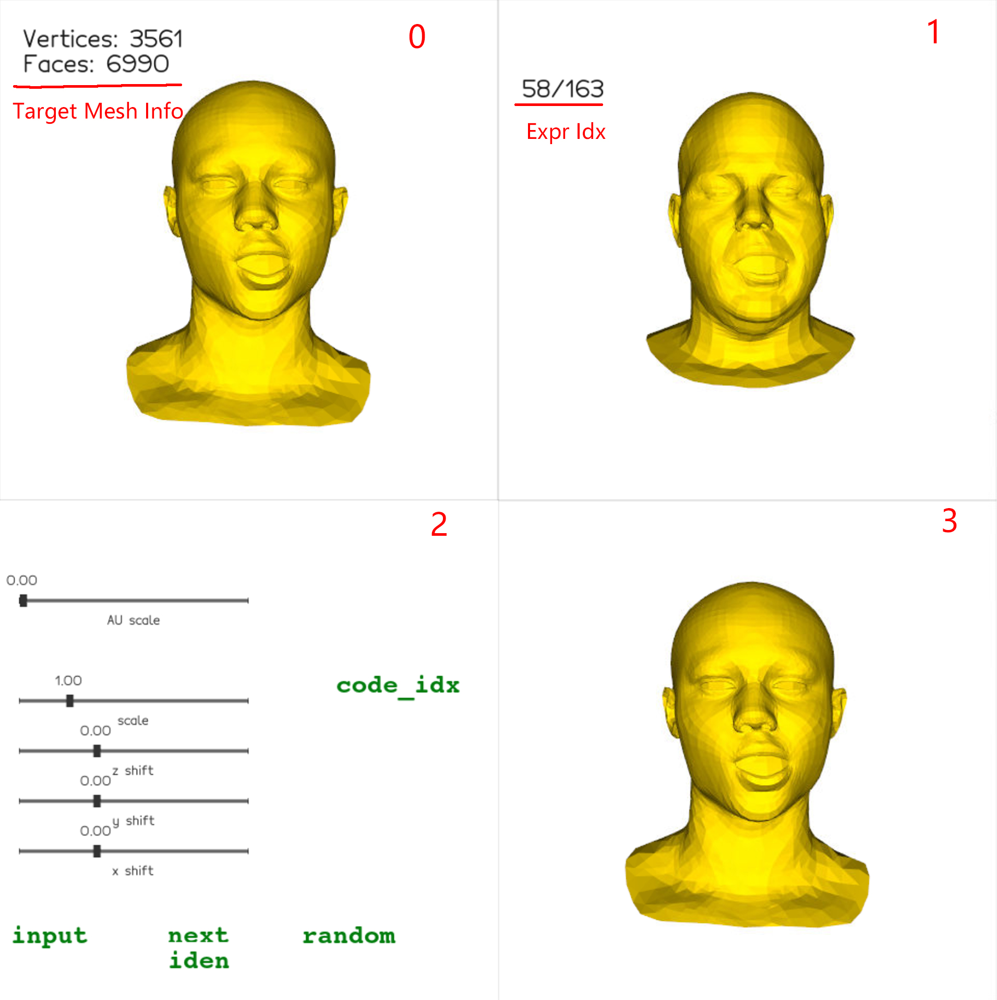

# NFR

This is the official implementation of the paper 'Neural Face Rigging for Animating and Retargeting Facial Meshes in the Wild'

## [Project Page](https://dafei-qin.github.io/NFR/) | [Paper](https://arxiv.org/abs/2305.08296)

Why try NFR?

NFR can transfer facial animations to any customized face mesh, even with different topology, without any labor for manual rigging or data capturing. For facial meshes obtained from any source, you can quickly retarget exising animations onto the mesh and see the results in real-time.

## Testing Setup

**This release is tested under Ubuntu 20.04, with a RTX 4090 GPU. Other GPU models with CUDA should be OK as well.** 

**The testing module utilizes [vedo](https://vedo.embl.es/) for interactive visualization. Thus a display is required.**

**Windows is currently not supported unless you manually install the pytorch3d package following [their official guide](https://github.com/facebookresearch/pytorch3d/blob/main/INSTALL.md).**

1. Create an environment called NFR
```shell
conda create -n NFR python=3.9
conda activate NFR
```

2. Recommend mamba to accelerate the installation process
```shell
conda install mamba -c conda-forge
```


3. Install necessary packages via mamba
```shell
mamba install pytorch=1.12.1 cudatoolkit=11.3 pytorch-sparse=0.6.15 pytorch3d=0.7.1 cupy=11.3 numpy=1.23.5 -c pytorch -c conda-forge -c pyg -c pytorch3d
```

4. Install necessary packages via pip
```shell
pip install potpourri3d trimesh open3d transforms3d libigl robust_laplacian vedo
```

5. Download the preprocess data and the pretrained model here: [Google Drive](https://drive.google.com/file/d/1cXXeU3AtpoGEVz2mhlWTSG1dEbAtCmD1/view?usp=sharing). Place them in the root directory of this repo.

6. Run!

```shell
python test_user.py -c config/test.yml
```

7. Interactive visualization

Here's the plot when you successfully run the script. You can interact with the sliders and buttons to change the expression of the source mesh, and manually adjust the expression by FACS-like codes.


- Zone 0: The source mesh
- Zone 1: The target mesh (with source mesh's expression transferred)
- Zone 2: The source mesh under ICT Blendshape space
- Zone 3: Interactive buttons and sliders
    - Buttons:
        - code_idx: input (0-52) the FACS code index to the terminal
        - input/next/random: change the source expression index
        - iden: change the source identity
    - Sliders:
        - AU scale: Change the intensity of the FACS code specified by *code_idx*
        - scale: Scale uniformly the target mesh
        - x/y/z shift: Shift the target mesh

### Pre-processed facial animation sequences
Currently we have two pre-processed facial animation sequences, one from [ICT](https://github.com/ICT-VGL/ICT-FaceKit) and another from [Multiface](https://github.com/facebookresearch/multiface). You can swith between them by changing the `dataset` and `data_head` variables in the `config/test.yml` file. 

### Using your customized data

You can test with your own mesh as the target. This has two requirement:
1. There should be no mouth/eye/nose sockets and eye balls inside the face. Otherwise bad deformations may occur on those area. 
2. The mouth and eyes need to be cut for correct global solving. Please refer to the preprocessed meshes in the `test-mesh` folder as examples.
3. Remember to roughly align your mesh to the examples in blender via the align.blend file!

## Training

### Additional dependencies

On top of the testing setup, training needs:

```
mamba install -c pyg pytorch-scatter pytorch-sparse
pip install tensorboardX
```

Install `pytorch-scatter`/`pytorch-sparse` through conda rather than pip: pip
falls back to building them from source, which fails whenever the system CUDA
version differs from the one PyTorch was compiled against.

Note that `dataset_preprocess.py` invokes helper scripts through
`subprocess.call(['python', ...])` **without checking the return code**. Activate
the environment first, and check the produced file counts after each step —
a failing sub-step is otherwise silent.

### Data

The training data is derived from [ICT-FaceKit](https://github.com/ICT-VGL/ICT-FaceKit)
and [Multiface](https://github.com/facebookresearch/multiface). The full set
used in the paper is about 800GB; to get the pipeline running first, we provide
a smaller pack covering the `ICT_single_coarse` dataset.

**Sample data pack** (3.0GB, *link to be added*) — 40 identities, containing
only the files that cannot be regenerated:

```
data/ICT_single_coarse/{train,val,test}/*_processed_matrix.pkl
data/ICT_single_coarse/*_neutral.obj
data/ICT_single_coarse/{iden_exp_weights_single.npz,ICT_single_exp_weights.npy,gradients_std.npy}
data/ICT_live_100/gradients_std.npy   # referenced by std_file
data/MF_all_v5/img_stat.pkl           # referenced by img_file
```

Unpack it at the repository root and regenerate the derived tensors:

```
python dataset_preprocess.py \
    --data_dir ./data/ICT_single_coarse \
    --save_data_dir ./data/ICT_single_coarse \
    -pi -pg -pd --num_threads 8
```

The four switches are sequential — `-pm` converts raw meshes into the
`_processed_matrix.pkl` files that the other three read, so it is the only step
the sample pack lets you skip:

| Switch | Produces | Per identity | Time |
|---|---|---|---|
| `-pm` | `*_processed_matrix.pkl` | 75 MB | depends on mesh count |
| `-pi` | `*_imgs.npy`, `*_imgs.pt`, neutral renders | 400 MB | ~14 s |
| `-pg` | `*_grad.pt` | 51 MB | ~25 s |
| `-pd` | `*_dfn_info.pt` | 270 MB | ~7 s |

Regenerating all 40 identities takes roughly 30 minutes and 32GB of disk.

### Running

```
python FWH_run.py -c config/train_single.yaml
```

`config/train_single.yaml` trains on `ICT_single_coarse` alone and is the
recommended starting point. `config/train_release.yaml` is the full setup
(`dataset: ICT_all`), which loads five ICT datasets at once.

Measured on a single Tesla T4 (16GB) with `--batch_size 4`:

| | `train_single.yaml` | `train_release.yaml` |
|---|---|---|
| Datasets | ICT_single_coarse | ICT_single_coarse + random_50 + live_100 + shift_scale + holes |
| Peak RAM | ~24 GB | **~320 GB** |
| Disk | ~32 GB | ~550 GB |
| Data loading | 169 s first run, 35 s cached | hours |
| Per epoch | 159 s train + 28 s eval | — |

The RAM figure for the full config is not a typo. `--debug` only truncates the
*training* identities; validation and test splits are always loaded in full, and
a single `ICT_random_50` identity is ~28GB. Use `train_single.yaml` unless you
have a machine with several hundred GB of RAM.

Two further caveats for the full config: the augmented datasets
(`ICT_shift_scale`, `ICT_holes`) expect an `exp_vecs.npy` holding their 92x53
FACS coefficients, which ships with the preprocessed data and is not produced by
any script here; and `*_imgs.npy` and `*_imgs.pt` store the same renders twice,
so roughly half the image footprint is redundant.

### Preprocessing your own meshes

To turn a folder of per-identity mesh sequences into a training/testing dataset:

1. Roughly align one of your meshes to the examples in Blender using
   `align.blend`, then build the transform with `myutils.blender2transform()`
   and pickle it.
2. Convert the sequences (one subfolder of `.obj` files per identity):

   ```
   python s_data/process_obj.py --data_dir <your_meshes> \
       --transform <transform.pkl> --output_dir <out>
   ```

3. Compute deformation gradients and the derived tensors:

   ```
   python dataset_preprocess.py --data_dir <out>/npy \
       --save_data_dir ./data/<your_dataset> \
       --sequences -pm -pi -pg -pd --num_threads 8
   ```

   Without `--split` everything lands in `test/`, which is what you want for
   retargeting. Add `--split` to get a train/val/test division, but note it
   assigns the last two sequences of each identity to test and the two before
   them to validation — so each identity needs at least five sequence files for
   the training split to be non-empty.

The same mesh requirements as in [Using your customized data](#using-your-customized-data)
apply. One extra constraint: identity names must not contain underscores, since
the neutral mesh is looked up by splitting the filename on `_`.

## Citation


```
@inproceedings{qin2023NFR,
          author = {Qin, Dafei and Saito, Jun and Aigerman, Noam and Groueix Thibault and Komura, Taku},
          title = {Neural Face Rigging for Animating and Retargeting Facial Meshes in the Wild},
          year = {2023},
          booktitle = {SIGGRAPH 2023 Conference Papers},
      }
```

## Acknowledgement

This project uses code from [ICT](https://github.com/ICT-VGL/ICT-FaceKit), [Multiface](https://github.com/facebookresearch/multiface), [Diffusion-Net](https://github.com/nmwsharp/diffusion-net), data from ICT and Multiface, testing mesh templates from ICT, Multiface, [COMA](https://github.com/anuragranj/coma), [FLAME](https://flame.is.tue.mpg.de/), [MeshTalk](https://github.com/facebookresearch/meshtalk). Thank you!